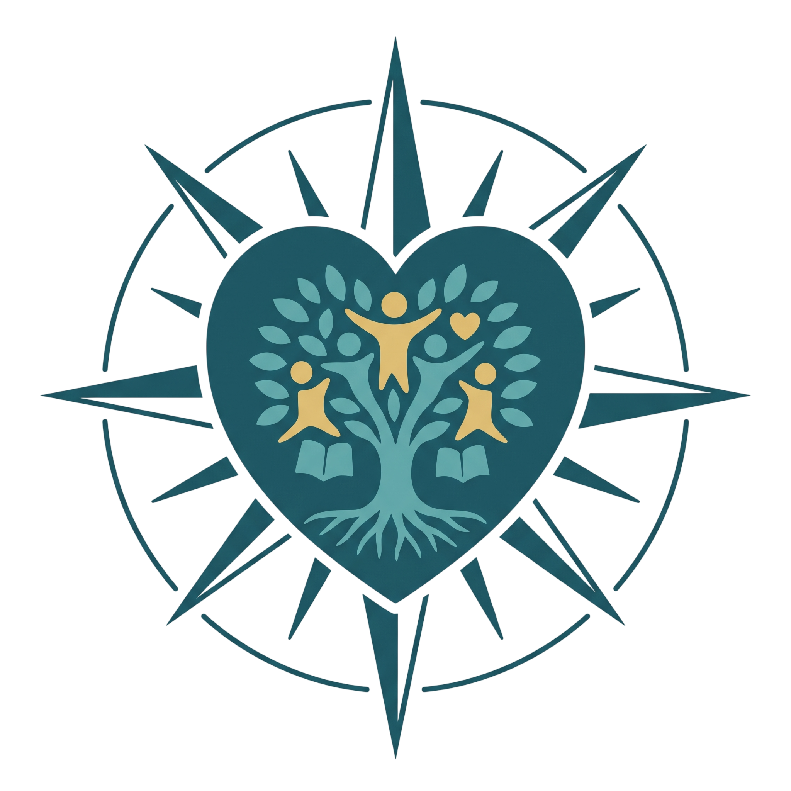
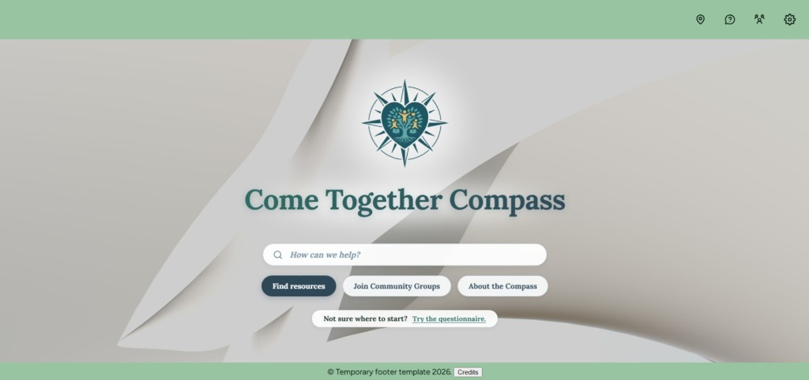
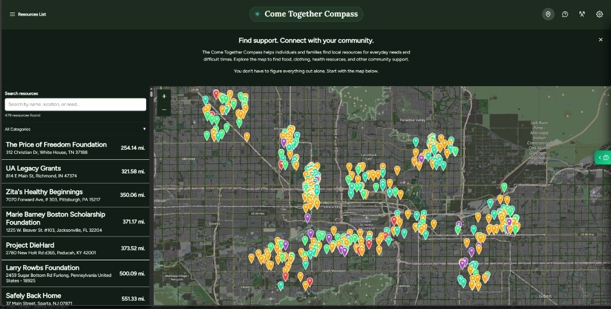
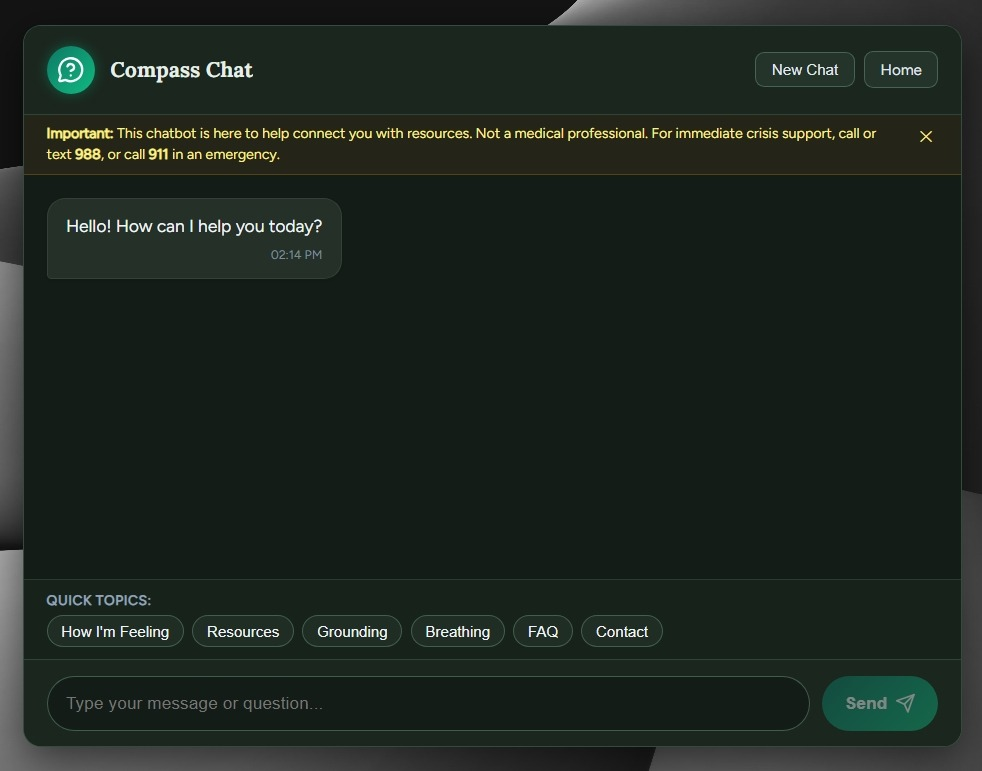
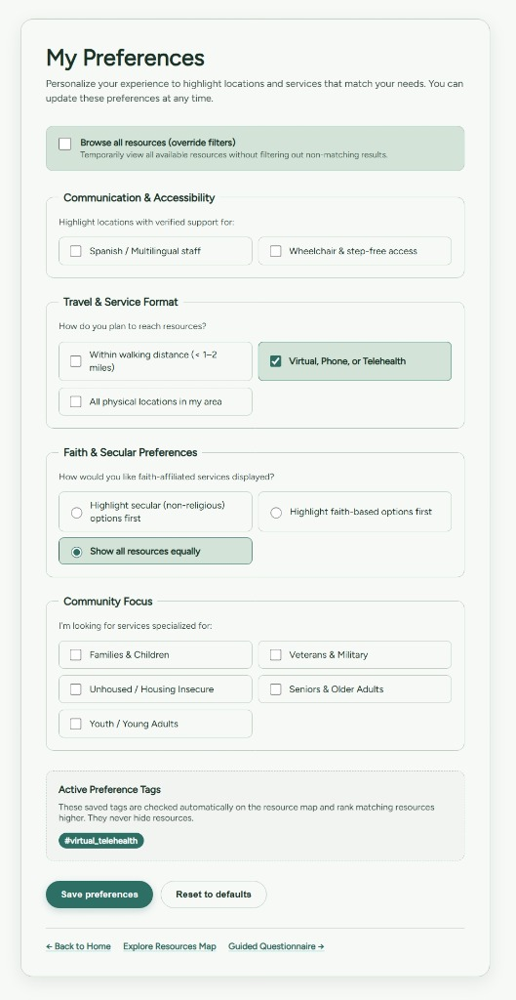

<!-- Improved compatibility of back to top link: See: https://github.com/othneildrew/Best-README-Template/pull/73 -->
<a id="readme-top"></a>
<!--
*** Thanks for checking out the Best-README-Template. If you have a suggestion
*** that would make this better, please fork the repo and create a pull request
*** or simply open an issue with the tag "enhancement".
*** Don't forget to give the project a star!
*** Thanks again! Now go create something AMAZING! :D
-->


<!-- PROJECT SHIELDS -->
<!--
*** I'm using markdown "reference style" links for readability.
*** Reference links are enclosed in brackets [ ] instead of parentheses ( ).
*** See the bottom of this document for the declaration of the reference variables
*** for contributors-url, forks-url, etc. This is an optional, concise syntax you may use.
*** https://www.markdownguide.org/basic-syntax/#reference-style-links
-->
[![Contributors][contributors-shield]][contributors-url]
[![Forks][forks-shield]][forks-url]
[![Stargazers][stars-shield]][stars-url]
[![Issues][issues-shield]][issues-url]
[![project_license][license-shield]][license-url]
[![LinkedIn][linkedin-shield]][linkedin-url]


<!-- PROJECT LOGO -->
<br />
<div align="center">
  <a href="https://github.com/Come-Together-Compass/Come-Together-Compass-Showcase">
    
  </a>

<h3 align="center">Come Together Compass</h3>

  <p align="center">
    A community resource locator and intake platform developed for Community Pay It Forward (ASU Capstone Team #6).
    <br />
    <a href="https://github.com/Come-Together-Compass/Come-Together-Compass-Showcase"><strong>Explore the docs »</strong></a>
    <br />
    <br />
    <a href="https://github.com/Come-Together-Compass/Come-Together-Compass-Showcase">View Demo</a>
    &middot;
    <a href="https://github.com/Come-Together-Compass/Come-Together-Compass-Showcase/issues/new?labels=bug&template=bug-report---.md">Report Bug</a>
    &middot;
    <a href="https://github.com/Come-Together-Compass/Come-Together-Compass-Showcase/issues/new?labels=enhancement&template=feature-request---.md">Request Feature</a>
  </p>
</div>


<!-- TABLE OF CONTENTS -->
<details>
  <summary>Table of Contents</summary>
  <ol>
    <li>
      <a href="#about-the-project">About The Project</a>
      <ul>
        <li><a href="#built-with">Built With</a></li>
      </ul>
    </li>
    <li>
      <a href="#getting-started">Getting Started</a>
      <ul>
        <li><a href="#prerequisites">Prerequisites</a></li>
        <li><a href="#installation">Installation</a></li>
      </ul>
    </li>
    <li>
      <a href="#usage">Usage</a></li>
    <li><a href="#roadmap">Roadmap</a></li>
    <li><a href="#contributing">Contributing</a></li>
    <li><a href="#license">License</a></li>
    <li><a href="#contact">Contact</a></li>
    <li><a href="#acknowledgments">Acknowledgments</a></li>
  </ol>
</details>


<!-- ABOUT THE PROJECT -->
## About The Project

[![Product Name Screen Shot][product-screenshot]](https://github.com/Come-Together-Compass/Come-Together-Compass-Showcase)

Come Together Compass is a senior capstone project currently in active development with a team of 5 engineers for the non-profit organization Community Pay It Forward. The web platform connects families and individuals in need with verified local assistance programs such as food pantries, emergency shelters, and healthcare services through an interactive map, conversational guidance, and administrative verification.

The platform is designed around accessibility and user privacy:
* Connects with the public U.S. Census Bureau REST geocoding service and Leaflet/OpenStreetMap to avoid expensive third-party mapping fees.
* Operates an ephemeral chatbot keeping intake answers strictly in volatile Pinia runtime memory, guaranteeing zero persistent tracking.
* Provides an instant one-click exit and session purge with direct linkage to the 988 Suicide & Crisis Lifeline.
* Equips community partners and administrators with a role-based portal to curate, approve, and maintain local assistance listings.

<p align="right">(<a href="#readme-top">back to top</a>)</p>


### Built With

* [![Vue][Vue.js]][Vue-url]
* [![TypeScript][TypeScript]][TypeScript-url]
* [![Vite][Vite]][Vite-url]
* [![Pinia][Pinia]][Pinia-url]
* [![Express][Express.js]][Express-url]
* [![PostgreSQL][PostgreSQL]][PostgreSQL-url]
* [![Prisma][Prisma]][Prisma-url]
* [![Leaflet][Leaflet]][Leaflet-url]

<p align="right">(<a href="#readme-top">back to top</a>)</p>


<!-- GETTING STARTED -->
## Getting Started

To get a local copy up and running, follow these simple steps.

### Prerequisites

* Node.js (v20+ LTS recommended)
  ```sh
  nvm install 20
  nvm use 20
  ```
  _Note: Node v20.6+ requires running `npx prisma generate` to keep Prisma client types in sync with schema updates._
* PostgreSQL (v14+)
  ```sh
  # macOS (Homebrew)
  brew install postgresql@15 && brew services start postgresql@15
  # Windows
  winget install PostgreSQL.PostgreSQL
  ```

### Installation

1. Clone the repo
   ```sh
   git clone https://github.com/Come-Together-Compass/Come-Together-Compass-Showcase.git
   ```
2. Install NPM packages
   ```sh
   npm install
   ```
3. Set up environment variables
   ```sh
   cp .env.template .env
   cp src/server/.env.example src/server/.env
   ```
4. Generate Prisma client, run migrations, and seed database
   ```sh
   npx prisma generate
   npx prisma migrate dev
   npx prisma db seed
   ```
5. Start development servers
   ```sh
   # Terminal 1: Backend API
   npm run server
   # Terminal 2: Frontend client
   npm run dev
   ```

<p align="right">(<a href="#readme-top">back to top</a>)</p>


<!-- USAGE EXAMPLES -->
## Usage

Come Together Compass provides three core access paths:

* **Community Portal & Search:** Search assistance programs by address, city, or need with rapid access to verified food, shelter, and medical support.

  <p align="center">
    
  </p>

* **Interactive Resource Map:** Search community resources by zip code, city, or live location. Filter by category (food, housing, healthcare) with proximity calculations and detailed listing information.

  <p align="center">
    
  </p>

* **Conversational Intake Chatbot:** Guided conversational flow to match visitors with suitable community resources based on needs and accessibility preferences, operating entirely in volatile memory.

  <p align="center">
    
  </p>

* **Personalized Preferences:** Tailor search results by transit proximity, communication needs, and service format (in-person vs. telehealth) without compromising privacy.

  <p align="center">
    
  </p>

_For more examples, please refer to the [Documentation](https://github.com/Come-Together-Compass/Come-Together-Compass-Showcase)_

<p align="right">(<a href="#readme-top">back to top</a>)</p>


<!-- ROADMAP -->
## Roadmap

- [x] PostgreSQL relational database
- [x] Automated public data ingestion pipeline
- [x] Address geocoding and automated entity deduplication
- [x] RESTful API with category and proximity filtering
- [x] Interactive Leaflet map with localized resource pins
- [x] Virtual crisis hotline and phone support integration
- [x] Search bar with resource filters
- [x] Color-coded resource category tags and detail cards
- [ ] Picture-first onboarding questionnaire and personalized suggestions
- [ ] Finalized in-memory navigation assistant
- [ ] Real-time crisis detection with 1-tap 988/211 emergency redirection
- [ ] Interactive grounding tools (box breathing animation and sensory exercises)
- [ ] Admin portal for direct resource management
- [ ] User accounts and saved favorite resources
- [ ] Offline mode and local caching
- [ ] Multilingual support
- [ ] Community groups and peer discussion forums
- [ ] AWS cloud deployment and custom domain setup

See the [open issues](https://github.com/Come-Together-Compass/Come-Together-Compass-Showcase/issues) for a full list of proposed features (and known issues).

<p align="right">(<a href="#readme-top">back to top</a>)</p>


<!-- CONTRIBUTING -->
## Contributing

Contributions are what make the open source community such an amazing place to learn, inspire, and create. Any contributions you make are **greatly appreciated**.

If you have a suggestion that would make this better, please fork the repo and create a pull request. You can also simply open an issue with the tag "enhancement".
Don't forget to give the project a star! Thanks again!

1. Fork the Project
2. Create your Feature Branch (`git checkout -b feature/AmazingFeature`)
3. Commit your Changes (`git commit -m 'Add some AmazingFeature'`)
4. Push to the Branch (`git push origin feature/AmazingFeature`)
5. Open a Pull Request

<p align="right">(<a href="#readme-top">back to top</a>)</p>

### Contributors:

<a href="https://github.com/TimothyH3">
  
</a>

<a href="https://github.com/M-AZEEM1">
  
</a>

<a href="https://github.com/mcbower6">
  
</a>

<a href="https://github.com/rkeng01">
  
</a>

<a href="https://github.com/mzima-heap">
  
</a>

<!-- LICENSE -->
## License

Distributed under the ISC License. See `LICENSE.txt` for more information.

<p align="right">(<a href="#readme-top">back to top</a>)</p>


<!-- CONTACT -->
## Contact

Timothy Hansen - [@timothy_hansen](https://twitter.com) - t@tjhansen.net

Project Link: [https://github.com/Come-Together-Compass/Come-Together-Compass-Showcase](https://github.com/Come-Together-Compass/Come-Together-Compass-Showcase)

<p align="right">(<a href="#readme-top">back to top</a>)</p>


<!-- ACKNOWLEDGMENTS -->
## Acknowledgments

* [Community Pay It Forward](https://communitypayitforward.us/)
* [Arizona State University - Capstone Program](https://engineering.asu.edu/)
* [U.S. Census Bureau Geocoding Services](https://geocoding.geo.census.gov/)
* [OpenStreetMap & Leaflet](https://leafletjs.com/)
* [988 Suicide & Crisis Lifeline](https://988lifeline.org/)
* [Best-README-Template](https://github.com/othneildrew/Best-README-Template)

<p align="right">(<a href="#readme-top">back to top</a>)</p>


<!-- MARKDOWN LINKS & IMAGES -->
<!-- https://www.markdownguide.org/basic-syntax/#reference-style-links -->
[contributors-shield]: https://img.shields.io/github/contributors/Come-Together-Compass/Come-Together-Compass-Showcase.svg?style=for-the-badge
[contributors-url]: https://github.com/Come-Together-Compass/Come-Together-Compass-Showcase/graphs/contributors
[forks-shield]: https://img.shields.io/github/forks/Come-Together-Compass/Come-Together-Compass-Showcase.svg?style=for-the-badge
[forks-url]: https://github.com/Come-Together-Compass/Come-Together-Compass-Showcase/network/members
[stars-shield]: https://img.shields.io/github/stars/Come-Together-Compass/Come-Together-Compass-Showcase.svg?style=for-the-badge
[stars-url]: https://github.com/Come-Together-Compass/Come-Together-Compass-Showcase/stargazers
[issues-shield]: https://img.shields.io/github/issues/Come-Together-Compass/Come-Together-Compass-Showcase.svg?style=for-the-badge
[issues-url]: https://github.com/Come-Together-Compass/Come-Together-Compass-Showcase/issues
[license-shield]: https://img.shields.io/badge/License-ISC-blue.svg?style=for-the-badge
[license-url]: https://opensource.org/licenses/ISC
[linkedin-shield]: https://img.shields.io/badge/-LinkedIn-black.svg?style=for-the-badge&logo=linkedin&colorB=555
[linkedin-url]: https://linkedin.com/in/timothy-hansen-dev
[product-screenshot]: assets/images/compass-map-preview.jpg
[Vue.js]: https://img.shields.io/badge/Vue.js-35495E?style=for-the-badge&logo=vuedotjs&logoColor=4FC08D
[Vue-url]: https://vuejs.org/
[TypeScript]: https://img.shields.io/badge/TypeScript-007ACC?style=for-the-badge&logo=typescript&logoColor=white
[TypeScript-url]: https://www.typescriptlang.org/
[Vite]: https://img.shields.io/badge/Vite-646CFF?style=for-the-badge&logo=vite&logoColor=white
[Vite-url]: https://vitejs.dev/
[Pinia]: https://img.shields.io/badge/Pinia-FFE56C?style=for-the-badge&logo=pinia&logoColor=black
[Pinia-url]: https://pinia.vuejs.org/
[Express.js]: https://img.shields.io/badge/Express.js-000000?style=for-the-badge&logo=express&logoColor=white
[Express-url]: https://expressjs.com/
[PostgreSQL]: https://img.shields.io/badge/PostgreSQL-316192?style=for-the-badge&logo=postgresql&logoColor=white
[PostgreSQL-url]: https://www.postgresql.org/
[Prisma]: https://img.shields.io/badge/Prisma-2D3748?style=for-the-badge&logo=prisma&logoColor=white
[Prisma-url]: https://www.prisma.io/
[Leaflet]: https://img.shields.io/badge/Leaflet-199900?style=for-the-badge&logo=leaflet&logoColor=white
[Leaflet-url]: https://leafletjs.com/
